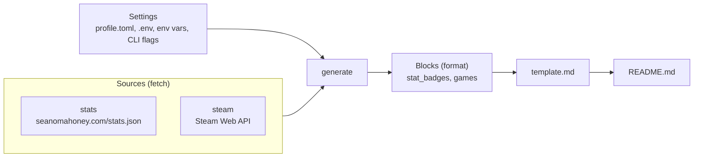

# profile-gen

profile-gen builds the [Sean12697 GitHub profile](https://github.com/Sean12697) README from a Markdown template plus live data, and a scheduled GitHub Action in this same repository commits the result every morning. Edit `template.md`, never `README.md`: the README is regenerated on every run.

## How it works



The pipeline has three kinds of module, each with one job:

| Module | Lives in | Job | Appears in the template as |
| :-- | :-- | :-- | :-- |
| Source | `src/profile_generator/sources/` | Fetch data and return a JSON-serialisable dict | `{{ <source>.<field> }}` |
| Block | `src/profile_generator/blocks/` | Turn context data into a Markdown or HTML snippet | `{{ blocks.<name> }}` |
| Template | `template.md` | Layout and all static content | |

## Data sources

**stats** reads [seanomahoney.com/stats.json](https://seanomahoney.com/stats.json) and exposes `stats.hackathons` (`timeline.hackathons`), `stats.beer_festivals` (`timeline.beerFestivals`) and `stats.beers` (`untappd.formattedBeers`, for example "6,000+"). The whole document is also available as `stats.raw`, so any other figure can go straight into the template, for example `{{ stats.raw.content.blogPosts }}`.

**steam** lists recently played games for `steam_id`: playtime over the last two weeks and in total, achievement progress, and a "new" marker for games first played in the last two weeks. Games are sorted by recent playtime. Titles carrying any of the `steam_blocked_descriptors` content descriptors are hidden, and games without achievements simply show no progress bar. It needs a [Steam Web API key](https://steamcommunity.com/dev/apikey) and the Steam profile's game details set to public.

## Quick start

Requires Python 3.11 or later. There are no runtime dependencies beyond the standard library.

```bash
pip install -e ".[dev]"
profile-gen render --offline --stdout   # preview with bundled demo data, writes nothing
cp .env.example .env                    # then set PROFILE_STEAM_API_KEY (or STEAM_API_KEY)
profile-gen render                      # fetch live data, write README.md and the snapshot
```

## Commands

| Command | What it does |
| :-- | :-- |
| `profile-gen render` | Fetch every source, render `template.md`, write `README.md` |
| `profile-gen render --stdout` | Same, but print the result and write nothing |
| `profile-gen render --offline` | Use the bundled demo data instead of the network |
| `profile-gen fetch` | Print the fetched data and any failures as JSON |
| `profile-gen check` | Render the template against demo data and fail on unknown placeholders |
| `profile-gen settings` | Show effective settings (secrets masked) |
| `profile-gen settings --env-example` | Print a `.env.example` generated from the settings model |

The Makefile wraps the common ones: `make dev`, `make test`, `make lint`, `make preview`, `make render`.

## Settings

Precedence, lowest to highest: built-in defaults, the `[settings]` table in `profile.toml`, `.env`, environment variables, then CLI flags. Keep secrets out of `profile.toml`, which is committed.

| Setting | Env var | Default | What it does |
| :-- | :-- | :-- | :-- |
| `template` | `PROFILE_TEMPLATE` | `template.md` | Markdown template with {{ placeholders }}. |
| `output` | `PROFILE_OUTPUT` | `README.md` | Where the rendered profile is written. |
| `stats_url` | `PROFILE_STATS_URL` | `https://seanomahoney.com/stats.json` | Portfolio stats (hackathons, festivals, Untappd). |
| `steam_id` | `PROFILE_STEAM_ID` | `76561198101964519` | SteamID64 whose recent games are shown. |
| `steam_api_key` | `PROFILE_STEAM_API_KEY` or `STEAM_API_KEY` | (empty) | Steam Web API key. Leave empty to skip Steam. |
| `steam_games` | `PROFILE_STEAM_GAMES` | `5` | How many recently played games to show. |
| `steam_fetch` | `PROFILE_STEAM_FETCH` | `10` | How many recent games to request before filtering. |
| `steam_blocked_descriptors` | `PROFILE_STEAM_BLOCKED_DESCRIPTORS` | `3` | Steam content descriptor ids to hide (3 = adult only sexual content). |
| `timeout` | `PROFILE_TIMEOUT` | `20.0` | HTTP timeout in seconds per request. |
| `retries` | `PROFILE_RETRIES` | `2` | Retries for transient HTTP failures (5xx, 429, network). |
| `offline` | `PROFILE_OFFLINE` | `False` | Use bundled demo data instead of the network. |
| `strict` | `PROFILE_STRICT` | `False` | Exit non-zero if any source fails (instead of using the snapshot). |

## Editing the template

`template.md` is ordinary GitHub Markdown and HTML with `{{ dotted.path }}` placeholders. `{# ... #}` comments are stripped before rendering, so notes to yourself never reach the profile. An unknown placeholder fails the run rather than shipping a blank, and `profile-gen check` catches it before you push. Available values:

| Placeholder | Example |
| :-- | :-- |
| `{{ stats.hackathons }}` | 28 |
| `{{ stats.beer_festivals }}` | 38 |
| `{{ stats.beers }}` | 6,000+ |
| `{{ stats.raw.<path> }}` | anything in stats.json |
| `{{ blocks.stat_badges }}` | three shields.io badges for the numbers above |
| `{{ blocks.games }}` | recently played games table |
| `{{ generated_at }}` | 19 October 2026, 07:00 UTC |
| `{{ generated_date }}` | 2026-10-19 |

Keep blank lines out of HTML blocks (`<table>`, `<p>`) and leave a blank line after `<summary>` lines, otherwise GitHub stops rendering the Markdown inside them.

## Adding a source or block

1. Add `sources/<name>.py` with `fetch(settings, http) -> dict` and an `EMPTY` dict, raising `SourceError` when it cannot produce data.
2. Register both in `SOURCES` and `EMPTY` in `sources/__init__.py`.
3. If the data needs formatting, add `blocks/<name>.py` with `render(ctx) -> str` and register it in `BLOCKS`.
4. Add any new settings to the `Settings` dataclass, regenerate `.env.example` with `make env-example`, and add tests using the `FakeHttp` helper so nothing touches the network.

## GitHub Action

`.github/workflows/update.yml` runs at 07:00 UTC daily, on manual dispatch, and on pushes to `main` that touch the template, settings or code. It installs the package, checks the template, renders, and commits `README.md` as github-actions[bot] using the built-in `GITHUB_TOKEN` (so no personal access token is needed). The footer timestamp changes every run, so there is a commit every day, and that activity stops GitHub disabling the schedule after 60 days without repository activity. Pushes made with `GITHUB_TOKEN` do not trigger further workflow runs, so there is no loop.

One repository secret is needed: `STEAM_API_KEY`. In the repository settings, Actions must have read and write permission for workflow tokens (the workflow also requests `contents: write`).

`.github/workflows/ci.yml` runs ruff and the tests on Python 3.11 to 3.13 for pull requests and code pushes.

## Testing

```bash
make test    # pytest; the suite is plain unittest, so python -m unittest discover -s tests also works
make lint
```

Tests never use the network: `tests/helpers.py` provides `FakeHttp`, which routes each URL to a canned response, callable or exception.
